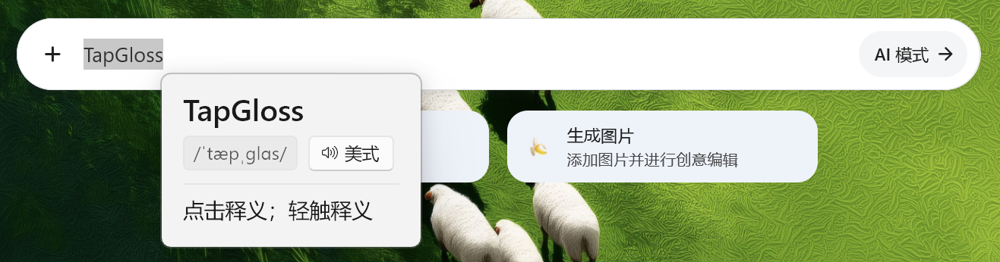

  

<h1 align="center">TopGloss（轻触释义）</h1>

轻量的 Windows 托盘翻译工具。选中英文，按 <kbd>Alt</kbd> + <kbd>T</kbd>，就能看到英文简中译文。

# 使用说明

## 安装

1. 在 x64 Windows 上安装 [.NET 10 Desktop Runtime（x64）](https://dotnet.microsoft.com/en-us/download/dotnet/10.0) 和 [Windows App Runtime 2.6.5（x64）](https://learn.microsoft.com/windows/apps/windows-app-sdk/downloads#stable-release)。
2. 完整解压运行包，双击其中的 `TapGloss.exe`。
3. 右键系统托盘中的应用图标，打开 **设置 API Key**，填入自己的 DeepSeek API Key。

## 日常使用

在浏览器或编辑器里选中英文，按 **Alt+T**。译文会在选区或光标附近弹出，点击浮窗外即可收起。

  

查单词时，浮窗会显示可用的美式音标，并用本地 Amy 女声自动朗读一次。点击 **美式** 可以重听。翻译通过 DeepSeek 联网完成，朗读在本机离线完成。

## 模式切换

右键系统托盘图标，选择 **模式切换**。两种模式都会在程序启动时静默预热 Amy，区别在于闲置后是否释放语音模型。

| 模式 | 行为 |
| --- | --- |
| **动态续热（默认）** | 每次朗读后重新计时。闲置 15 分钟后释放模型，下次朗读时重新加载。 |
| **静态常驻** | 模型一直留在内存里，直到退出程序。适合频繁查词、希望随时快速发音的场景。 |
