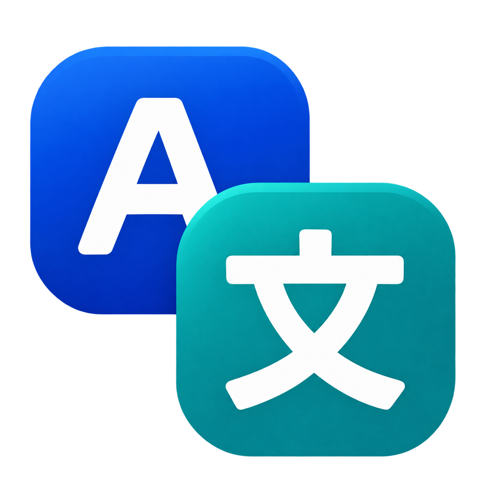
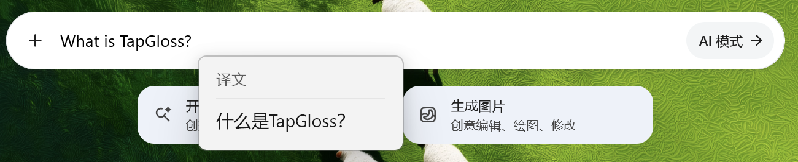
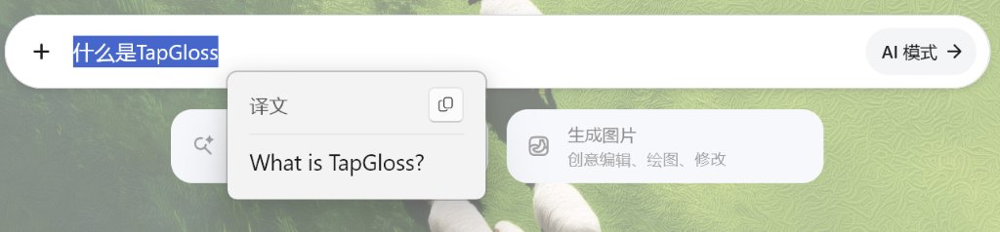

<p align="center">
  
</p>

<h1 align="center">TapGloss（轻触释义）</h1>

<p align="center">轻量的 Windows 托盘翻译工具，采用 WinUI，现代原生。</p><p align="center">选中文字后按 <kbd>Alt</kbd> + <kbd>T</kbd> 英译中，或按 <kbd>Alt</kbd> + <kbd>R</kbd> 将中文或中英混合文字译为英文。</p>

# 说明

## 安装

1. 在 x64 Windows 上安装 [.NET 10 Desktop Runtime（x64）](https://dotnet.microsoft.com/en-us/download/dotnet/10.0) 和 [Windows App Runtime 2.6.5（x64）](https://learn.microsoft.com/windows/apps/windows-app-sdk/downloads#stable-release)。
2. 在 [GitHub Releases](https://github.com/munamizi/TapGloss/releases) 的 **Assets** 下载 `TapGloss-win-x64.zip`。完整解压后会得到一个 `TapGloss` 文件夹，把整个文件夹放到常用位置，然后双击里面的 `TapGloss.exe`。
3. 右键系统托盘中的应用图标，打开 **设置 API Key**，填入自己的 DeepSeek API Key。

## 使用

在浏览器或编辑器里选中文字，译文会在选区或光标附近弹出，点击浮窗外即可收起。

- **Alt+T** 将英文译为简体中文。
- **Alt+R** 将中文或中英混合文字译为英文。点击译文浮窗右上角的剪刀按钮，可将原输入框中的选中文字替换为英文译文。

**英译中单词**：浮窗显示中文译文和可用的美式音标，并用本地 Amy 女声自动朗读一次。点击 **美式** 可以重听。

单词默认优先给出**日常高频释义**和**计算机领域常用释义**，省略冷门释义。如果两类都有，计算机义排在前面。

<p align="center">
  
</p>

**英译中短语或句子**：浮窗显示中文译文。

<p align="center">
  
</p>

**中译英（Alt+R）**：支持中文单词、句子或中英混合文本，统一翻译为自然英文并保留原有分段和代码标识。右上角的复制按钮可复制完整译文。点击旁边的「替换选中文字」按钮会收起浮窗，把英文粘贴回原输入框的选区，并在粘贴后恢复原剪贴板。期间如果复制了新内容，TapGloss 会保留新内容。终端窗口可使用复制按钮。

<p align="center">
  
</p>

翻译通过 DeepSeek 联网完成，Amy 朗读在本机离线完成。

### 模式切换

右键系统托盘图标，选择 **模式切换**。英译中快捷键可用时，程序启动会静默预热 Amy。两种模式决定模型在闲置后是否释放。

| 模式 | 行为 |
| --- | --- |
| **动态续热（默认）** | 每次朗读后重新计时。闲置 15 分钟后释放模型，下次朗读时重新加载。 |
| **静态常驻** | 模型一直留在内存里，直到退出程序。适合频繁查词、希望随时快速发音的场景。 |

## 架构

TapGloss 用 C# 和 .NET 10 编写，托盘菜单和译文浮窗使用 WinUI 3。按下翻译快捷键后，程序按以下流程处理。

1. **读取选区**。用 Windows UI Automation 读取当前应用选中的文字。遇到不支持直接读取的应用，会尝试通过临时复制取得选区。
2. **翻译并显示**。将取得的文字交给 DeepSeek，按快捷键指定的方向取得译文，再在选区或光标附近显示浮窗。
3. **本地朗读**。TapGloss 通过独立语音进程调用 sherpa-onnx，由 Amy 离线合成英文发音，再使用 Windows 当前默认设备播放。

## 构建 Windows x64 发布包

解压 [sherpa-onnx 官方 Amy 模型包](https://github.com/k2-fsa/sherpa-onnx/releases/download/tts-models/vits-piper-en_US-amy-medium.tar.bz2)，把含 `tokens.txt` 和 `espeak-ng-data` 的目录传给 `AmyVoiceBundle`。本项目固定使用兼容内置发音前端的 sherpa-onnx 1.13.8。发布时会用生成的 `TapGloss.exe` 实际加载模型并合成测试音频。

```powershell
dotnet publish .\src\WindowsLookup.App\WindowsLookup.App.csproj -c Release --self-contained false "-p:AmyVoiceBundle=<解压后的模型目录>"
```
